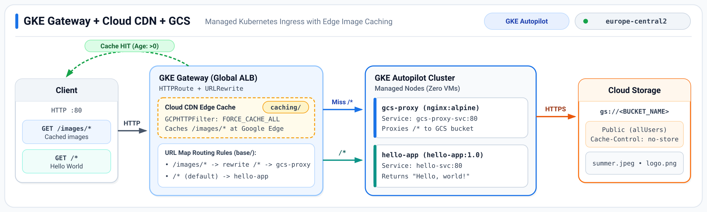
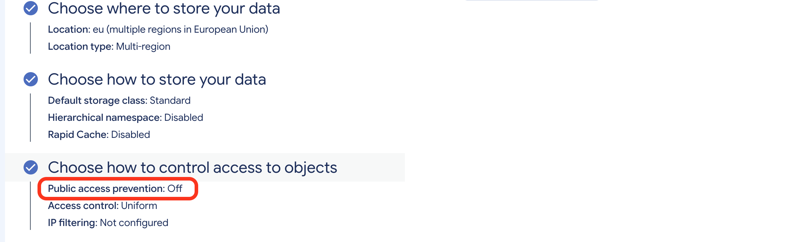
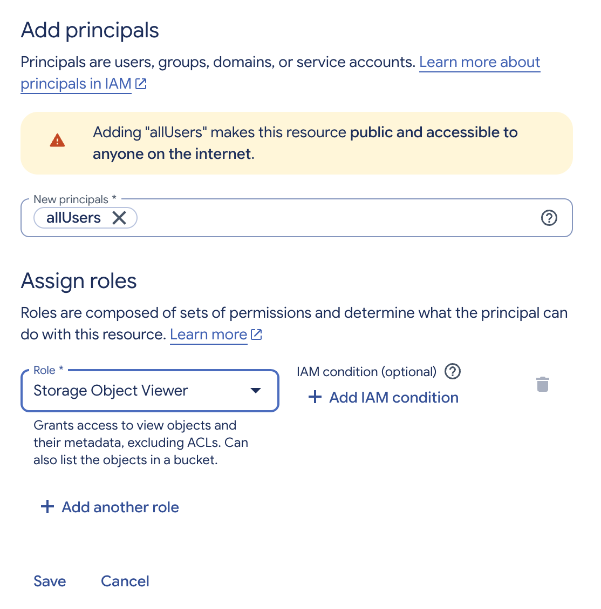
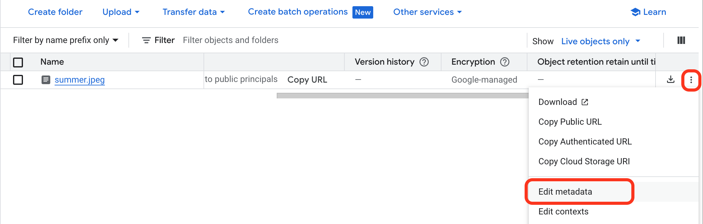
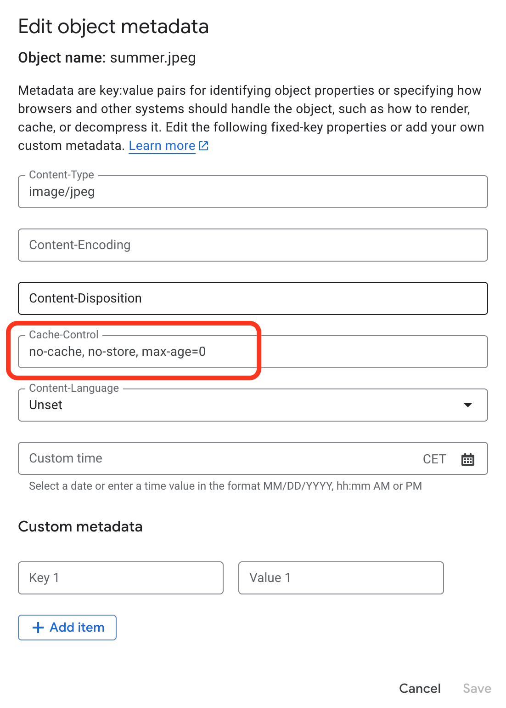
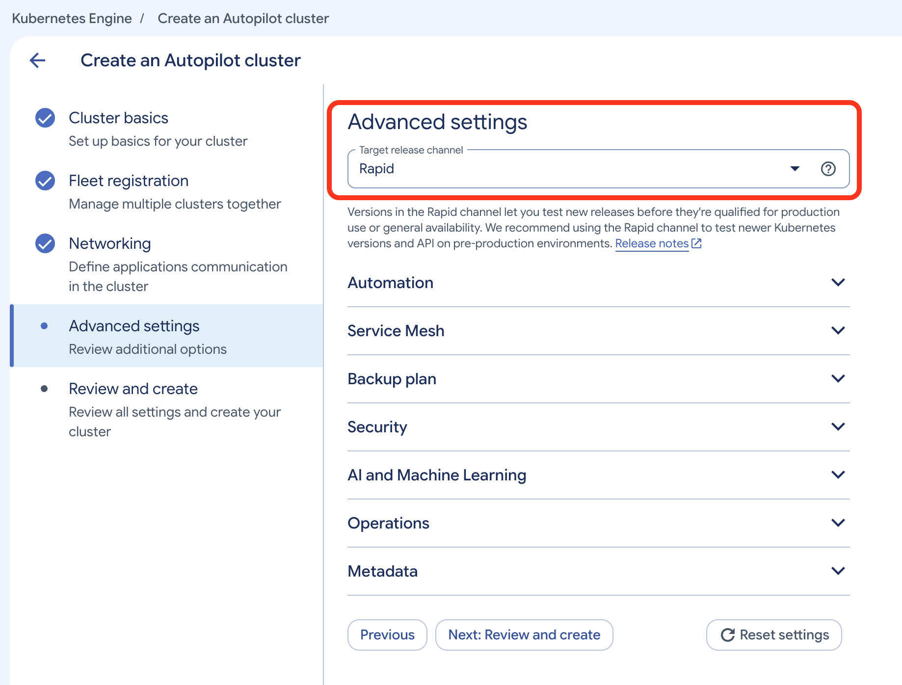
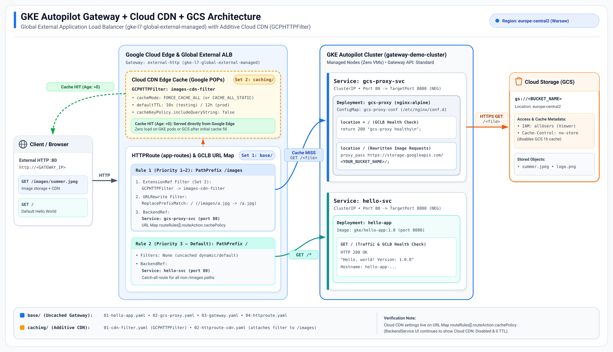

# GKE Gateway + GCS Image Routing with Optional Cloud CDN Caching

This repository demonstrates how to expose workloads on a **GKE Autopilot** cluster (with all compute/nodes managed by Google) behind a **Global External GKE Gateway** (`gke-l7-global-external-managed`), routing:

- `/*` (default) → in-cluster `hello-app` HTTP server
- `/images/*` → path-rewritten (`/*`) via an in-cluster NGINX reverse proxy (`gcs-proxy`) → a **Google Cloud Storage (GCS)** bucket





The Kubernetes manifests are split into two directories so you can deploy and verify the uncached Gateway first, then layer Cloud CDN caching on top:

```text
.
├── base/
│   ├── 01-hello-app.yaml       # Default "/" Deployment & ClusterIP Service
│   ├── 02-gcs-proxy.yaml       # "/images" NGINX reverse proxy to GCS (edit <YOUR_BUCKET_NAME>)
│   ├── 03-gateway.yaml         # Global External GKE Gateway (gke-l7-global-external-managed)
│   └── 04-httproute.yaml       # HTTPRoute without caching (/images -> gcs-proxy-svc, / -> hello-svc)
├── caching/
│   ├── 01-cdn-filter.yaml      # Cloud CDN caching policy (GCPHTTPFilter)
│   └── 02-httproute-cdn.yaml   # Updated HTTPRoute attaching GCPHTTPFilter to /images
└── README.md
```

> **Why an in-cluster `gcs-proxy` Service?**  
> GKE Gateway `HTTPRoute` backends must be Kubernetes `Service`s (not direct GCS `BackendBucket`s, and the GKE Gateway controller continuously reconciles and overwrites manual edits to the underlying URL Map). Routing `/images/*` through a lightweight `nginx:alpine` Service lets GKE Gateway manage the load balancer natively while Cloud CDN caches responses at Google's edge.

---

## Prerequisites & Environment Variables

Open **Cloud Shell** (or a local terminal with `gcloud` and `kubectl` configured) and set your shared variables:

```bash
export PROJECT_ID=$(gcloud config get-value project)
export REGION=europe-central2
export BUCKET_NAME="${PROJECT_ID}-cdn-images"
export CLUSTER_NAME=gateway-demo-cluster
```

---

## Step 1: Set Up the GCS Bucket and Upload a Test Image

1. Go to **Cloud Storage > Buckets** and click **Create**.
2. Enter your bucket name (e.g., `<YOUR_PROJECT_ID>-cdn-images`) and choose region **`europe-central2`**.
3. Under **Choose how to control access to objects**, uncheck **Enforce public access prevention on this bucket** (keep **Uniform** access control), then click **Create**.



4. Open the **Permissions** tab → **Grant access**, set **New principals** to `allUsers`, select role **Storage Object Viewer**, and click **Save** (confirm **Allow public access**).



5. Open the **Objects** tab and upload a test image (e.g., `summer.jpeg` or `logo.png`).
6. *(Recommended to disable GCS's built-in cache for Step 3)* Click the three-dots menu (**⋮**) on your uploaded object → **Edit metadata**, set **Cache-Control** to `no-cache, no-store, max-age=0`, and click **Save**.





> **Why set `Cache-Control: no-cache, no-store, max-age=0` on GCS objects?**  
> By default, GCS attaches `Cache-Control: public, max-age=3600` to publicly readable objects, which enables GCS's own built-in 1-hour cache and browser caching even when Cloud CDN is disabled. Setting `no-store` ensures `base/` has zero caching anywhere.  
> *(Note: If you prefer keeping the bucket private without `allUsers`, mount it into `gcs-proxy` using GKE's Cloud Storage FUSE CSI driver + Workload Identity.)*

---

## Step 2: Create a GKE Autopilot Cluster

> **Version requirement:** `GCPHTTPFilter` (used in `caching/`) requires **GKE `1.35.2-gke.1751000` or later** and a global external Gateway (`gke-l7-global-external-managed`).

1. Go to **Kubernetes Engine > Clusters** and click **Create**.
2. Ensure **Autopilot** mode is selected (all underlying node VMs are managed by GKE).
3. Under **Cluster basics**:
   - **Name:** `gateway-demo-cluster`
   - **Region:** `europe-central2`
   - **Release channel:** **Rapid** (or **Regular** if `1.35.2-gke.1751000+` is already the default in your region)
   - **Register to a fleet:** Leave **unchecked** (only required for Multi-Cluster Gateways)
4. Under **Networking**, verify **Enable Gateway API** is set to **Standard**.
5. Click **Create**. Once ready, click **Connect** and run the `gcloud container clusters get-credentials` command.



---

## Step 3: Deploy the Gateway Without Caching (`base/`)

1. Edit `base/02-gcs-proxy.yaml` and replace `<YOUR_BUCKET_NAME>` with your GCS bucket name:
   ```yaml
   proxy_pass https://storage.googleapis.com/<YOUR_BUCKET_NAME>/;
   ```

2. Apply everything in `base/`:
   ```bash
   kubectl apply -f base/
   ```
   *(You may see a harmless `Warning: autopilot-default-resources-mutator` message — this simply means Autopilot automatically injected default CPU/memory requests for containers without explicit `resources.requests`.)*

3. Wait for pods to start and for the Gateway to receive an external IP address (typically 2–5 minutes):
   ```bash
   kubectl rollout status deployment/hello-app deployment/gcs-proxy
   kubectl get gateway external-http -w
   ```

4. Test both routes (uncached):
   ```bash
   export GATEWAY_IP=$(kubectl get gateway external-http -o jsonpath='{.status.addresses[0].value}')

   # Default "/" -> Hello World app
   curl -i "http://${GATEWAY_IP}/"

   # "/images/<file>" -> GCS via gcs-proxy (no Age header; Cache-Control comes from GCS)
   curl -sD - -o /dev/null "http://${GATEWAY_IP}/images/summer.jpeg"
   ```

---

## Step 4: Enable Cloud CDN Caching (`caching/`)

### Choose the right `cacheMode` in `caching/01-cdn-filter.yaml`
- **`FORCE_CACHE_ALL`** *(recommended if your GCS objects have `Cache-Control: no-store` from Step 1)*: Ignores origin `Cache-Control` directives and caches all successful responses at Google's edge for `defaultTTL`.
- **`CACHE_ALL_STATIC`**: Caches static content types, **unless** the origin sends `Cache-Control: no-store` or `private` (and uses the origin's `max-age` if present).

Example `caching/01-cdn-filter.yaml` (using a `10s` TTL for quick testing, or `12h` for production):
```yaml
apiVersion: networking.gke.io/v1
kind: GCPHTTPFilter
metadata:
  name: images-cdn-filter
spec:
  cachePolicy:
    cacheMode: FORCE_CACHE_ALL
    defaultTTL: 10s
    cacheKeyPolicy:
      includeQueryString: false
```

Apply `caching/`:
```bash
kubectl apply -f caching/
```

---

## Step 5: Verify Cloud CDN Configuration & Edge Cache Hits

### 1. Verify Kubernetes Reconciliation
```bash
kubectl get gcphttpfilter images-cdn-filter -o yaml
kubectl describe httproute app-routes
```
Confirm `Status.Parents.Conditions` shows `Accepted: True` and `Reconciled: True` (`ReconciliationSucceeded`).

### 2. Inspect the Generated GCP URL Map
> **Console UI Note:** When Cloud CDN is configured via `GCPHTTPFilter`, GKE programs caching onto the **URL Map route rules** (`routeRules[].routeAction.cachePolicy`), **not** onto the GCE `BackendService`. Viewing the `BackendService` in the Cloud Console will continue to show **Cloud CDN: Disabled** and `0` TTLs — this is expected.

Inspect the actual URL Map programmed by the Gateway controller:
```bash
export URL_MAP=$(kubectl get gateway external-http \
  -o jsonpath='{.metadata.annotations.networking\.gke\.io/url-maps}')

gcloud compute url-maps describe "${URL_MAP##*/}" --format="yaml(pathMatchers)"
```
Under the `/images/` and `/images` `routeRules`, confirm `cachePolicy` is present with your configured `cacheMode` and `defaultTtl`.

### 3. Verify Live Edge Cache Hits (`Age:` Header)
Run two `GET` requests a few seconds apart (allow ~1–2 minutes after applying `caching/` for the URL Map update to propagate):
```bash
export GATEWAY_IP=$(kubectl get gateway external-http -o jsonpath='{.status.addresses[0].value}')

curl -sD - -o /dev/null "http://${GATEWAY_IP}/images/summer.jpeg" | grep -iE '^(HTTP|Age|Cache-Control)'
sleep 3
curl -sD - -o /dev/null "http://${GATEWAY_IP}/images/summer.jpeg" | grep -iE '^(HTTP|Age|Cache-Control)'
```
On the second request, you should see an **`Age:`** header (e.g., `Age: 3`), confirming Google's edge cache served the image without hitting GKE or GCS.

---

## Full Architecture



---

## Optional: Disable Caching or Clean Up

### Revert to Uncached Gateway (Keep Cluster & Gateway Running)
```bash
kubectl apply -f base/04-httproute.yaml
kubectl delete -f caching/01-cdn-filter.yaml
```

### Delete All Cloud Resources
```bash
kubectl delete -f caching/ --ignore-not-found
kubectl delete -f base/ --ignore-not-found

gcloud container clusters delete "${CLUSTER_NAME}" --location="${REGION}" --quiet
gcloud storage rm -r "gs://${BUCKET_NAME}"
```